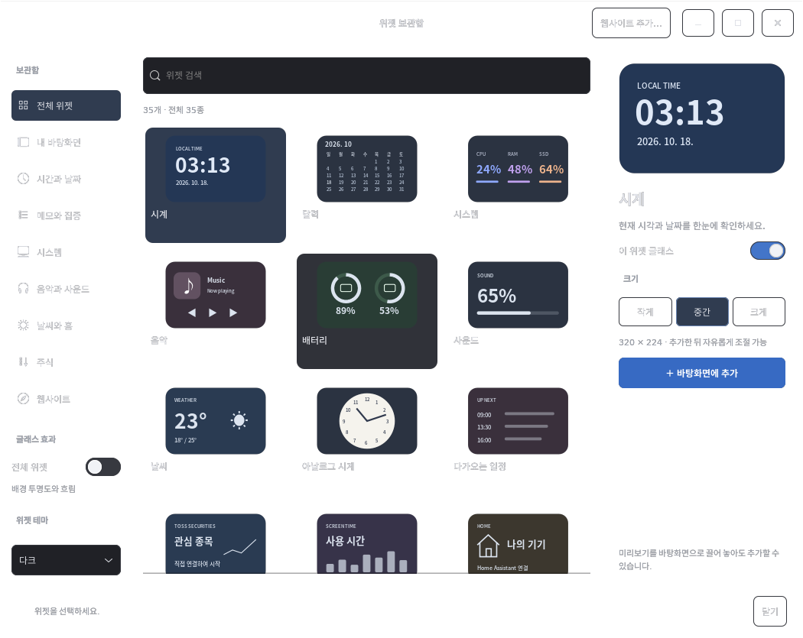

# Ubuntu Widget

[English](README.md) | **한국어**

[](https://github.com/KweonTJ/Ubuntu_Widget/actions/workflows/ci.yml)

**Ubuntu GNOME의 Xorg 환경**에서 사용하는 macOS 스타일의 바탕화면 위젯 보관함입니다. **기본 제공 항목 34개** 중에서 원하는 위젯을 골라 개별적으로 추가하고, 16 px 그리드에 맞춰 배치할 수 있습니다. 위젯은 둥근 모서리, 반응형 레이아웃, 라이트·다크 테마와 선택 가능한 글래스 효과를 공통으로 제공합니다.

Apple 제품이 아닌 독립적인 커뮤니티 프로젝트입니다. 현재 앱 화면은 주로 한국어로 제공됩니다. 영어 README는 위 언어 링크에서 볼 수 있으며, 추가 문서는 영어로 제공됩니다.



*초기 설정 상태의 미리보기입니다. 카드의 수치는 예시이며, 개인 바탕화면이나 계정 정보는 포함하지 않습니다.*

## Ubuntu 지원 범위

| 환경 | 지원 상태 |
| --- | --- |
| **Ubuntu 22.04 LTS, GNOME 42, Xorg, x86-64** | **바탕화면 동작 검증 완료**(22.04.5 LTS에서 테스트). 이동, 삭제, 크기 조절, 테마 및 바탕화면 아이콘과의 창 순서를 확인했습니다. |
| Ubuntu 24.04 LTS, GNOME 46, **Xorg** | **실험적 지원 / 바탕화면 동작 미검증.** 소스에서 빌드해야 하며, 블러가 필요하면 해당 GNOME 버전에 맞는 Blur my Shell을 사용해야 합니다. 자동 패키지 검사만으로 전체 바탕화면 호환성을 보장하지 않습니다. |
| Ubuntu 20.04 이하 | 지원하지 않습니다. 기본 Python 버전이 이 패키지의 요구 사항보다 낮습니다. |
| Ubuntu Desktop 25.10 이후(26.04 LTS 포함)의 기본 GNOME 세션 | 지원하지 않습니다. 이 GNOME 세션은 Wayland만 지원합니다. 이 패키지에서 XWayland는 전체 Xorg 세션을 대체할 수 없습니다. |
| Wayland 세션, 다른 데스크톱 환경 또는 CPU 아키텍처 | 이번 릴리스에서 검증하거나 지원하지 않습니다. |

**현재 실제 바탕화면 동작을 검증한 버전은 Ubuntu 22.04까지입니다.** Ubuntu 24.04는 실험 대상이며 호환성을 보장하지 않습니다. Wayland 전환에 관한 내용은 [Ubuntu의 GNOME/Xorg 공식 안내](https://discourse.ubuntu.com/t/ubuntu-25-10-drops-support-for-gnome-on-xorg/62538)와 [26.04 LTS 릴리스 노트](https://documentation.ubuntu.com/release-notes/26.04/summary-for-lts-users/)를 참고하세요.

설치 전에 현재 세션을 확인하세요.

```bash
echo "$XDG_SESSION_TYPE"  # x11이 출력되어야 합니다
```

지원되는 Ubuntu 환경에서는 필요에 따라 로그인 화면의 세션 메뉴에서 **Ubuntu on Xorg**를 선택하세요. Wayland에서는 위젯의 기본 이동·크기 조절 기능이 정상 동작하지 않습니다.

## 설치

실행 요구 사항: Python 3.10 이상, GTK 3, 전체 GNOME/Xorg 세션, 정상 동작하는 사용자 systemd/D-Bus 세션.

Ubuntu 패키지 관리자로 실행 및 빌드 의존성을 설치하세요.

```bash
sudo apt update
sudo apt install git build-essential pkg-config libgtk-3-dev libdbusmenu-gtk3-dev \
  python3 python3-gi python3-gi-cairo python3-cairo python3-dbus \
  gir1.2-gtk-3.0 gir1.2-secret-1 gnome-keyring libx11-6 libxss1 \
  pulseaudio-utils libnotify-bin xdg-utils fonts-noto-cjk
```

[rustup 공식 안내](https://rustup.rs/)에 따라 최신 stable Rust 도구 모음을 설치하세요. Rust는 패치된 Eww 엔진을 빌드할 때 필요하며, 빌드 후 일반적인 사용에는 필요하지 않습니다.

```bash
git clone https://github.com/KweonTJ/Ubuntu_Widget.git
cd Ubuntu_Widget
./scripts/build-eww.sh
./install.sh
"$HOME/.local/bin/ubuntu-widget" edit
```

- `build-eww.sh`는 Eww 커밋 `48f5aa8b379adf29da0b0bb9ca04164f65d8bdaa`를 가져와 이동·크기 조절 패치를 검사하고 적용한 뒤, X11 백엔드만 빌드합니다. 원본 프로젝트에 고정된 오래된 도구 모음 대신 설치된 **stable** Rust 도구 모음을 사용합니다. `RUST_TOOLCHAIN`으로 다른 설치된 도구 모음을 선택할 수 있습니다.
- 일반 Eww 바이너리에는 이 위젯에서 사용하는 사용자 정의 이동·크기 조절 속성이 **구현되어 있지 않습니다**. 패치된 엔진을 배포판의 Eww 패키지로 대체하지 마세요.
- 저장소는 소스와 패치를 배포합니다. 개발자의 로컬 실행 파일이나 바탕화면 백업을 배포하지 않습니다. 최초 바탕화면 검증에는 Ubuntu 22.04와 stable Rust 1.99.0을 사용했습니다.
- 빌드 중 메모리가 부족하면 `CARGO_BUILD_JOBS=2 ./scripts/build-eww.sh`로 다시 시도하세요.
- 이미 빌드한 **패치 적용 바이너리**가 있다면 `./install.sh --eww /path/to/eww`로 설치할 수 있습니다.
- 추가한 위젯을 로그인할 때 자동으로 실행하려면 설치 명령에 `--autostart`를 붙이세요. 기본값은 자동 실행 꺼짐입니다.
- 사용자별로 설치되며 설치 스크립트 실행에 `sudo`가 필요하지 않습니다. 별도로 사용 중인 다른 Eww 설정을 덮어쓰지 않습니다.

앱 메뉴에서 **Widget Library / 위젯 보관함**을 실행하세요. 처음 설치하면 바탕화면에 위젯이 없는 상태로 시작합니다. 원하는 위젯을 선택하고 **바탕화면에 추가**를 누르세요. 계정이 필요한 위젯은 본인의 계정을 연결하기 전까지 설정 안내를 표시합니다.

## 제공 위젯

| 분류 | 항목 |
| --- | --- |
| 시간과 날짜(9개) | 디지털 시계, 달력, 아날로그 시계, 다가오는 일정, 세계 시계, 오늘 날짜, 하루 진행률, 연간 진행률, 디데이 |
| 메모와 집중(3개) | 메모, 할 일, 집중 타이머 |
| 시스템(8개) | 시스템 요약, 배터리, 스크린 타임, CPU, 메모리, 저장 공간, 네트워크 속도, 가동 시간 |
| 미디어(3개) | 음악, 음량, 팟캐스트 |
| 날씨와 홈(2개) | 날씨, Home Assistant |
| 주식(1개) | 토스증권 관심 종목과 시장 지수 |
| 웹사이트 바로가기(8개) | Notion, 네이버 메일, Gmail, Google Calendar, Google Keep, YouTube, Spotify, GitHub |

웹사이트 항목은 사이트를 여는 실행기입니다. 로그인한 웹페이지를 Eww 카드 안에 내장하지 않습니다. 원하는 URL을 추가로 등록할 수 있습니다. Chrome 또는 Chromium이 있으면 독립된 앱 창으로 열고, 그 외에는 `xdg-open`으로 기본 브라우저를 실행합니다.

## 이동·크기 조절·삭제

- **이동:** 위젯 **안쪽 오른쪽 상단 모서리**를 드래그하세요. 16 px 그리드에 맞춰 이동합니다.
- **가로폭 조절:** 오른쪽 가장자리를 드래그하세요.
- **가로·세로 크기 조절:** 안쪽 오른쪽 하단 모서리를 드래그하세요.
- **삭제:** **안쪽 왼쪽 상단 모서리**를 클릭하거나, 마우스 오른쪽 버튼 메뉴 또는 보관함을 사용하세요. X 아이콘과 이동·크기 조절 표시는 보이지 않도록 되어 있습니다.
- **복원:** 보관함에서 위젯을 다시 추가하세요. 위젯을 삭제해도 저장된 내용은 지워지지 않습니다.
- **크기:** 작게 `208 × 208`, 중간 `320 × 224`, 크게 `432 × 352`, 최소 `192 × 96` 논리 픽셀입니다. 높이가 낮은 카드에서 넘치는 내용은 카드 안을 스크롤해 볼 수 있습니다.
- 가로폭이 좁아지면 내용이 세로로 정렬됩니다. 달력은 **일요일부터** 시작합니다.
- 바탕화면 아이콘용 투명 창이 조작을 가리지 않도록 위젯 아래에 유지합니다. 위젯은 일반 앱 창보다 아래에 표시됩니다.

## 사용자 설정이 필요한 위젯

보관함에서 위젯을 선택한 뒤 상세 화면의 **내용·시간 설정** 또는 **연결·설정**을 사용하세요.

### 주식 — 토스증권

- 본인의 [토스증권 WTS](https://www.tossinvest.com/)를 열고 **설정 → Open API**로 이동하세요.
- **Client ID / Client Secret**을 발급하고, 허용 IP 설정에 현재 **공인 IP 주소**를 등록하세요.
- 보관함에서 **주식 · 토스증권 → 연결·설정**을 선택하세요. 입력 내용이 가려지는 필드에 인증 정보를 직접 입력한 뒤 **연결 확인 및 저장**을 누르세요.
- 관심 종목 코드를 `005930,AAPL`처럼 쉼표로 구분해 입력하세요. 필요하면 `KOSPI,KOSDAQ` 같은 지수 코드도 입력할 수 있습니다. 제공 업체가 지원하는 코드 범위에서 종목 최대 12개, 지표 최대 12개를 설정할 수 있습니다.
- **관심 목록만 저장**을 누르면 키를 다시 입력하지 않고 목록만 수정할 수 있습니다. **연결 해제 · 저장된 키 삭제**를 누르면 이 앱에 저장된 인증 정보를 삭제합니다.
- 인증 정보와 재사용하는 액세스 토큰은 **GNOME Keyring / Secret Service**에 저장합니다. 평문 파일에 대신 저장하는 기능은 없습니다.
- 위젯을 추가한 동안 REST API로 **30초마다** 시세를 갱신합니다. 원본 데이터 시각과 조회 시각을 표시하며, 틱 단위 스트리밍은 제공하지 않습니다. 비교 가능한 캔들 데이터가 있을 때만 전일 종가 대비 등락률을 표시합니다.
- 잔고 조회나 주문은 수행하지 않습니다. 인증과 공개 시장 데이터 조회만 요청합니다.
- 토스는 클라이언트당 유효 토큰 하나를 허용합니다. 다른 프로그램과 토큰을 서로 무효화하지 않도록 별도 API 클라이언트를 사용하세요. 공인 IP가 바뀌면 토스의 허용 IP 목록도 갱신하세요.
- 공용 API 키는 제공하지 않습니다. API 이용 권한과 조건은 토스 정책에 따릅니다. [공식 API 안내](https://developers.tossinvest.com/docs)를 참고하세요.

### 날씨

- **날씨 → 연결·설정**에서 도시를 검색하고 올바른 결과를 선택해 저장하세요.
- 위치를 자동으로 추적하지 않습니다. 검색어와 선택한 좌표는 Open-Meteo로 전송됩니다.
- 현재 기온, 최저·최고 기온, 이후 6시간의 시간별 예보, 7일 예보, US AQI와 PM2.5를 표시합니다. 위젯을 추가한 동안 **15분마다** 갱신합니다.
- 대기 질은 CAMS 기반 예측값입니다. US AQI는 한국의 통합대기환경지수와 다릅니다.
- 포함된 어댑터는 Open-Meteo의 비상업용 공개 엔드포인트를 사용합니다. 상업적으로 배포하려면 적절한 서비스 요금제·어댑터를 마련하고 [제공 업체의 이용 약관](https://open-meteo.com/en/terms)을 따라야 합니다.
- 데이터 출처: **날씨 — Open-Meteo(CC BY 4.0), 대기 질 — CAMS / Open-Meteo**. [날씨 API](https://open-meteo.com/en/docs)와 [대기 질 API](https://open-meteo.com/en/docs/air-quality-api) 문서를 참고하세요.

### 홈 — Home Assistant

- 먼저 본인의 Home Assistant 서버에 기기를 등록하세요.
- Home Assistant 프로필에서 장기 액세스 토큰을 발급하세요. **홈 → 연결·설정**에 서버 기본 URL, 토큰과 엔티티 ID를 입력하세요.
- URL 예시: `http://homeassistant.local:8123`. 엔티티 예시: `light.living_room,sensor.temperature`.
- HTTP는 로컬 네트워크 주소에서만 허용합니다. 외부 서버에는 HTTPS를 사용하세요. 토큰은 GNOME Keyring에 저장합니다.
- `light`, `switch`, `sensor`, `binary_sensor`, `climate` 엔티티를 최대 12개까지 표시할 수 있습니다. 위젯을 추가한 동안 **30초마다** 상태를 갱신합니다.
- 조명과 스위치는 카드에서 켜고 끌 수 있습니다. 이번 릴리스에서 센서와 온도 조절기는 조회만 지원합니다.
- Home Assistant 서버에 연결하는 기능이며 Apple HomeKit 계정에 직접 연결하지 않습니다. [REST API 문서](https://developers.home-assistant.io/docs/api/rest/)를 참고하세요.

### 메모·할 일·날짜·집중

- **메모:** 제목과 최대 2,000자의 내용을 입력하세요. 자주 확인하는 짧은 메모에 적합합니다.
- **할 일:** 한 줄에 하나씩 최대 12개를 입력하세요. 바탕화면에서 항목을 클릭하면 완료 여부를 바꿀 수 있습니다.
- **다가오는 일정:** `YYYY-MM-DD HH:MM | 일정 제목` 형식으로 한 줄에 하나씩 최대 40개를 입력하세요. 다가오는 일정 12개를 표시합니다. 로컬 일정이며 Google·Apple 계정 동기화나 일정 알림은 제공하지 않습니다.
- **디데이:** 제목과 `YYYY-MM-DD` 형식의 날짜를 설정하세요.
- **집중 타이머:** 1~180분을 설정하고 위젯에서 시작·일시 정지·초기화하세요. 완료 알림을 받으려면 타이머의 데이터 수신 프로세스가 실행 중이어야 합니다.
- 디지털·아날로그 시계와 로컬 일정은 **시스템 시간대**를 사용합니다. 세계 시계에는 공개 예시 도시가 포함되어 있습니다. 도시를 바꾸려면 [설정 문서](docs/CONFIGURATION.md)에 따라 사용자 설정의 IANA 시간대 목록을 수정하세요.

### 스크린 타임

- 기록은 **기본적으로 꺼져 있습니다**. **스크린 타임 → 기록 설정**에서 직접 켜세요.
- 바탕화면 위젯이 하나 이상 열려 있는 동안 5초마다 활성 앱의 클래스·이름을 집계합니다. 창 제목, 문서 이름, URL은 저장하지 않습니다.
- 잠금 상태, 장시간 유휴 상태, 절전 중의 시간은 제외합니다. 표본으로 집계한 사용량이며 정확한 감사 로그는 아닙니다.
- 오늘의 총사용 시간과 상위 앱 8개를 표시합니다. 로컬 사용 기록은 최대 30일간 보관하며, 설정 창에서 기록을 중단하거나 지울 수 있습니다.

### 미디어와 블루투스 배터리

- **MPRIS**를 지원하는 플레이어나 브라우저에서 재생을 시작하세요. 음악·팟캐스트 카드는 활성 재생 세션과 사용 가능한 조작 버튼을 표시합니다. 자체 플레이어나 팟캐스트 목록은 포함하지 않습니다.
- 블루투스 배터리 잔량은 연결된 기기가 **BlueZ Battery1** 또는 해당 기기의 **UPower** 데이터를 제공해야 표시됩니다. 제공되지 않는 잔량은 `—`로 표시합니다.
- 음량 조절에는 `pactl`과 정상 동작하는 PulseAudio 세션 또는 PulseAudio 호환 기능이 있는 PipeWire 세션이 필요합니다.

### 나만의 웹사이트

- **＋ 웹사이트**를 누르고 이름과 `https://` URL을 입력해 바로가기를 추가하세요.
- 로그인은 해당 사이트의 브라우저 창에서 진행하세요. 위젯 보관함은 브라우저 쿠키를 읽거나 내보내지 않습니다.
- 대시보드, 메일, 캘린더, 내부 서비스 등에 활용할 수 있습니다. 비공개 URL은 설치된 사용자 설정에만 보관하고 Git에 올리지 마세요.

## 테마와 글래스 효과

- 보관함의 테마 선택에서 시스템 설정을 따르거나 라이트·다크를 직접 선택할 수 있습니다.
- 공개 패키지의 글래스 효과는 **기본적으로 꺼져 있습니다**. **글래스 효과 → 전체 위젯**으로 한꺼번에 켜거나 위젯별 스위치를 조절하세요.
- 실제 배경 블러에는 호환되는 [Blur my Shell](https://github.com/aunetx/blur-my-shell) 확장이 필요합니다. **버전 47 / GNOME 42** 조합에서 검증했습니다. 선택 사항이며 패키지에 포함하거나 자동 설치하지 않습니다.
- 다른 GNOME·확장 버전의 블러 동작은 검증하지 않았습니다. 반투명 카드 스타일은 계속 사용할 수 있으며, 지원하지 않는 설정 스키마 버전은 건너뜁니다.
- 실제 블러가 켜져 있는 동안 확장의 앱 블러, 불투명도, 다시 그리기 우회 설정을 임시 변경합니다. 마지막 글래스 효과를 끄면 다른 앱이 해당 값을 변경하지 않은 경우 저장된 값으로 복원합니다. 삭제 전에 글래스 효과를 꺼주세요.
- macOS 배경화면, 테마, 글꼴, 아이콘 팩 또는 Apple 소프트웨어는 포함하지 않습니다.

## 개인정보와 저장 위치

공개 기본 설정에는 **개인 메모, 일정, 관심 종목, 기기 ID, 비공개 URL, 좌표, 창 위치, API 키, 브라우저 데이터, 사용 기록, 녹화 파일, 로컬 실행 파일이 포함되지 않습니다**.

| 데이터 | 설치 후 저장 위치 |
| --- | --- |
| 설정과 로컬 콘텐츠 | `${XDG_CONFIG_HOME:-~/.config}/ubuntu-widget/` |
| 로그와 사용 기록 | `${XDG_CACHE_HOME:-~/.cache}/ubuntu-widget/` |
| API 인증 정보 | GNOME Keyring / Secret Service. 설정 경로를 기준으로 구분하여 저장 |
| 패치된 엔진 | `~/.local/lib/ubuntu-widget/eww` |
| 실행기 | `~/.local/bin/ubuntu-widget` |

분석 정보 수집용 서버는 없습니다. 네트워크 통신은 사용자가 연결·설정한 제공 업체와 직접 연 웹사이트로 제한됩니다. 설치된 사용자 설정을 커밋하거나 이를 공개 압축 파일로 배포하지 마세요. [개인정보 문서](docs/PRIVACY.md)를 참고하세요.

## 업데이트·삭제·문제 해결

```bash
git pull --ff-only
./scripts/build-eww.sh
./install.sh
"$HOME/.local/bin/ubuntu-widget" restart
```

설치 스크립트는 기존 메모, 계정, 웹사이트, 배치 및 기타 사용자 상태 파일을 보존합니다. 프로그램 파일과 기본 스타일은 교체되므로 직접 수정한 스타일은 업데이트 전에 따로 백업하세요.

```bash
./scripts/uninstall.py
```

삭제 후에도 개인 설정과 키링 항목은 남습니다. 인증 정보를 지우고 화면 합성기 설정을 복원하려면 먼저 앱에서 계정 연결을 해제하고 글래스 효과를 끄세요. 본인의 콘텐츠까지 지우려는 경우에만 로컬 설정·캐시를 직접 삭제하세요.

앱이 실행되지 않으면 캐시 폴더의 `gallery.log`와 `daemon.log`를 확인하세요. Xorg 세션, 패치된 엔진, 사용자 systemd/D-Bus 세션 및 잠금 해제된 GNOME Keyring을 확인하세요. 위젯 조작이 반응하지 않으면 엔진을 다시 시작하세요. 배치 상태를 감시하는 프로세스는 바탕화면 아이콘의 창 순서도 자동으로 복구합니다.

Apple의 iPhone 연속성 위젯은 **Ubuntu에서 사용할 수 없습니다**. 웹 인터페이스가 있는 서비스에는 웹사이트 바로가기를 제공하지만, iPhone 앱을 그대로 복제해 표시하지는 않습니다.

## 사용한 오픈소스

| 구성 요소 | 용도 | 라이선스 / 출처 |
| --- | --- | --- |
| [Eww](https://github.com/elkowar/eww) | 위젯 렌더링. 특정 커밋의 소스와 자체 이동·크기 조절 패치 사용 | MIT. [포함된 고지문](LICENSES/Eww-MIT.txt) |
| [GTK 3](https://www.gtk.org/), GLib/GIO, GDK | 네이티브 라이브러리, 대화상자, 테마, 바탕화면 연동 | LGPL. 시스템 의존성 |
| [PyGObject](https://pygobject.gnome.org/) | GTK/GIO/libsecret의 Python 바인딩 | LGPL-2.1-or-later |
| [Cairo / Pycairo](https://pycairo.readthedocs.io/) | 위젯 보관함 미리보기 그리기 | 원본 프로젝트의 LGPL/MPL 라이선스 |
| [D-Bus / dbus-python](https://www.freedesktop.org/wiki/Software/dbus/) | 세션 서비스, 미디어, 배터리, 키링 통신 | 원본 D-Bus 및 dbus-python 라이선스 |
| [libsecret](https://gnome.pages.gitlab.gnome.org/libsecret/) / [GNOME Keyring](https://gitlab.gnome.org/GNOME/gnome-keyring) | 인증 정보 저장 | 원본 프로젝트의 LGPL/GPL 라이선스 |
| [Blur my Shell](https://github.com/aunetx/blur-my-shell) | 선택적인 실제 배경 블러 | GPL-3.0-or-later. 패키지에 포함하지 않음 |
| [BlueZ](https://www.bluez.org/) / [UPower](https://upower.freedesktop.org/) | 블루투스·시스템 배터리 데이터 | 원본 프로젝트의 GPL/LGPL 라이선스. 시스템 서비스 |
| [PulseAudio](https://www.freedesktop.org/wiki/Software/PulseAudio/) 또는 [PipeWire](https://pipewire.org/)의 호환 기능 | `pactl`을 통한 음량 조절 | 시스템 서비스. 패키지에 포함하지 않음 |
| [Python](https://www.python.org/), [X.Org](https://www.x.org/), [systemd](https://systemd.io/) | 실행 환경, X11 제어, 사용자 서비스 | 각 원본 프로젝트의 라이선스 |
| [Noto CJK](https://github.com/notofonts/noto-cjk) | 한글 등 CJK 문자를 지원하는 권장 시스템 글꼴 | SIL Open Font License |

토스, Open-Meteo, Home Assistant HTTP 엔드포인트는 **외부 서비스 연동 대상**입니다. 자체 주식 데이터 서비스를 패키지에 포함하지 않습니다. 기본 웹사이트 항목은 URL이며 해당 앱의 복사본이 아닙니다. Chromium은 선택적으로 사용할 수 있는 오픈소스 브라우저입니다. 독점 소프트웨어인 Google Chrome도 사용자가 별도로 설치해 선택할 수 있습니다. 출처와 라이선스 링크는 [서드파티 고지문](THIRD_PARTY_NOTICES.md)을 참고하세요.

이 저장소에서 직접 작성한 설정, 스크립트, 네이티브 패치, SVG 그림은 [MIT 라이선스](LICENSE)로 배포합니다. 원본 프로젝트의 저작권과 라이선스는 각 프로젝트에 유지됩니다.

## 개발 시 검사

```bash
/usr/bin/python3 -m unittest discover -s tests -v
/usr/bin/python3 scripts/check_public.py
```

실제로 수행한 바탕화면 검증은 [검증 범위](docs/VALIDATION.md)를 참고하세요. CI는 Ubuntu 22.04와 24.04에서 패키지를 검사합니다. 초기 기본 설정, 다른 사용자 경로에서의 설치, 사용자 설정 보존, 모의 데이터를 사용한 API 어댑터, 소스 패치 적용 여부를 확인합니다. 이 검사는 GNOME 버전별 실제 바탕화면 테스트를 대신하지 않습니다.
