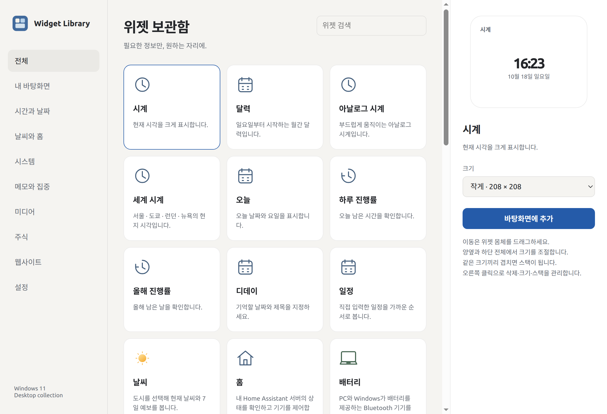

# Windows Widget

**English** · [한국어](README.ko.md)

A Windows 11 edition of [Ubuntu Widget](https://github.com/KweonTJ/Ubuntu_Widget), with an independent Electron renderer. Add information to your desktop from a searchable library, arrange cards on a 16 px grid, and match Windows light/dark mode with optional Acrylic glass.



The app interface is Korean. This project is independent of Microsoft and Apple. **This is the first Windows implementation; hardware integrations still require testing on Windows 11.** Ubuntu's Eww/GTK binaries are not used.

## Install

- Supported target: **Windows 11 x64**, build 22000 or later. Acrylic depends on the Windows version and the system's transparency settings. Windows 10 is not supported.
- Download and run [`windows-widget-1.0.0-x64-win.exe`](https://github.com/KweonTJ/Ubuntu_Widget/releases/download/windows-v1.0.0/windows-widget-1.0.0-x64-win.exe) from [GitHub Releases](https://github.com/KweonTJ/Ubuntu_Widget/releases/tag/windows-v1.0.0). The installer offers a per-user installation, destination selection, Start menu entry, desktop shortcut and uninstall entry. Administrator rights, Python, Eww and Node.js are not required.
- Alternatively extract the entire `windows-widget-1.0.0-x64-win.zip` and run **Widget Library.exe**. Keep the runtime files together.
- Open **Widget Library**, select a card and click **바탕화면에 추가**. Pin the library's taskbar icon using Windows' taskbar menu.
- Closing the library keeps widgets running. Open it again from the tray; choose **종료** in the tray menu to exit. Login startup is opt-in under **설정**.

The first launch starts with an empty desktop. The binaries are currently unsigned; Windows may show an unrecognized-publisher prompt. No automatic update service is enabled. Install future versioned packages over the existing installation to preserve settings.

## Desktop controls

| Action | Control |
| --- | --- |
| Move | Drag the widget body; buttons, task checkboxes and selectable note text keep their normal interactions. |
| Resize | Drag either side for width; drag anywhere along the bottom for height. Corner resizing is also supported. |
| Stack | Drop one card over another of the same width and height with at least 65% overlap. Existing stacks can merge. |
| Switch | Two-finger horizontal scroll on a Precision Touchpad, Shift + wheel, or the page counter. Vertical scrolling scrolls the contents. |
| Remove / split / presets | Right-click the card, or manage its entries in **내 바탕화면**. There is no visible close or move handle. |
| Theme and glass | **설정** → system / light / dark, Acrylic toggle. |

Sizes: 208 × 208, 320 × 224, 432 × 352; minimum 192 × 96 logical pixels. Width, height and placement snap to 16 px. The work area excludes the taskbar; monitor changes bring cards back into view. Each stack uses a single native window, preserving its position and size during transitions. Short content scrolls instead of shrinking text below readability.

Widgets are normal, independent, non-topmost Windows desktop windows, hidden from the taskbar. They do not inject into Explorer or replace the Windows Widgets board. **Win+D can hide them**; use the tray's **모든 위젯 표시** to bring them back. The library has a normal taskbar entry.

## Library and connections

| Group | Widgets |
| --- | --- |
| Time and date | Digital clock, analog clock, Sunday-first calendar, today, world clocks, day/year progress, countdown, local agenda |
| System | CPU, memory, system disk, network throughput, uptime, system overview, PC/Bluetooth battery, opt-in screen time, KDE Connect |
| Productivity | Obsidian Markdown note, todomate today list, focus timer with notification |
| Media and home | Windows media session music/podcasts with album cover and playback controls, sound settings, weather, Home Assistant |
| Web | Toss Securities shortcut, Notion, Naver Mail, Gmail, Google Calendar, Keep, YouTube, Spotify, GitHub and custom website |

**36 library entries**, including the custom website template. Website cards open the default browser. There are no invented live values or preconnected accounts.

- **Weather:** search for your city in the card settings, select a result, then Add/Save. Coordinates can also be entered manually. Uses [Open-Meteo](https://open-meteo.com/); no IP geolocation or account. Forecasts refresh every 10 minutes. [Weather data attribution: Open-Meteo / CC BY 4.0](https://open-meteo.com/en/terms).
- **Battery:** PC battery uses systeminformation. Bluetooth levels are best effort: Windows must report a connected device and expose its battery property. Unsupported devices stay absent; no guessed percentages. Desktop PCs may have no PC battery.
- **Music / podcasts:** reads the current Windows Global System Media Transport Controls session. The player must publish metadata and accept playback controls. Artwork is read directly from that session, not from a remote cover-search service. Windows' inbox PowerShell runs a bundled, fixed adapter; no user-entered command is evaluated. Polling is approximately 15–20 seconds.
- **todomate:** click **todomate 로그인 / 열기**, log in on the official page, then return to the desktop. Only today's own tasks are mirrored. Completing a task moves it below the unfinished tasks into a collapsed section. Expand it to undo completion. Session cookies remain in an isolated local Electron profile. Passwords and tokens do not cross the widget bridge. The adapter uses the official page's existing Firebase client; **this is not an official supported API**, and schema changes fail rather than inventing tasks. Email/password login is the initial target; third-party login can be restricted by the provider. **연결 해제** clears the local web session.
- **Obsidian:** select a Markdown file in your vault. The widget reads it, escapes markup, and refreshes its text; **Obsidian에서 열기** uses the installed Obsidian URI handler. Files above 1 MB are rejected. Edits remain in Obsidian.
- **KDE Connect:** install Windows KDE Connect in the default Program Files directory, pair a reachable device, enable sharing, then choose **파일 보내기…**, a device and the files. The file picker is the final user action before sending. Device IDs are shown; transfers and receiving are handled by KDE Connect.
- **Home Assistant:** enter your server URL, comma-separated entity IDs and your own long-lived access token. Tokens use Electron safeStorage (Windows user encryption), separate from layout JSON. Only explicitly listed light/switch entities receive toggle commands; other states are read-only. HTTPS certificates are validated.
- **Screen time:** enable **사용 시간 기록**. Records foreground executable names and approximate durations only while this app is running and system idle time is under 60 seconds. This is a local usage estimate, not Windows' full historical report. Disable recording to stop future collection. Delete `layout.json` to erase local history after exiting.
- **Toss Securities:** **website shortcut only in this Windows edition**. The Ubuntu API adapter has not been ported or validated; no API key or trading/order feature is exposed.
- **Agenda / countdown / focus:** local settings only; no calendar-account sync. Focus timers reset when the app exits.

No iPhone continuity, automatic Bluetooth pairing, account migration, system volume slider or Apple services are implemented.

## Local data and privacy

Data lives under `%APPDATA%\windows-widget\`: `layout.json` (cards, positions, selected paths, local usage), `credentials.json` (encrypted Home Assistant tokens), and Electron's isolated `Partitions\todomate` session. Each Windows account gets its own profile. Uninstall preserves this folder; exit first and delete it manually for a full reset. Distribution files contain only program code and clean defaults, not the Ubuntu user's data.

No telemetry. Weather contacts Open-Meteo only after a city is configured; todomate only when connected; Home Assistant only when configured; links only when clicked. Websites can have their own tracking policies.

## Develop and package

Use **Node.js 22 or later** on Windows 11:

```powershell
npm ci
npm test
npm start
npm run build
```

`dist/` receives the x64 NSIS installer and portable ZIP. For an experimental ARM64 build: `npm run build:arm64` (not validated on ARM hardware). Electron and all dependencies are pinned in `package-lock.json`.

The repository-root [Windows workflow](../.github/workflows/windows.yml) runs model/render tests, checks the native PowerShell adapter, runs an isolated UI smoke test, and builds packages with SHA-256 checksums from `windows-widget/`. Tags `windows-v*` select Windows versions independently of Ubuntu tags. The workflow uploads build artifacts; publish reviewed artifacts through GitHub Releases. Keep each tag version equal to this folder’s package.json.

Builds can be made from Linux using electron-builder and the included NSIS script, but that is **not a Windows 11 runtime test**. The local smoke test uses a clean profile, renders all 36 library entries at minimum size, captures the library, checks add/update/remove IPC, and exercises stack merge/split. See [validation](docs/VALIDATION.md).

Main edit points: `src/catalog.cjs` (library), `renderer/app.js` (card content), `renderer/style.css` (design/responsiveness), `src/model.cjs` (geometry/stacks), `src/providers.cjs` and `native/windows.ps1` (data), `src/main.cjs` (windows/IPC).

## Releases

Packages and detailed notes belong in versioned GitHub Releases. Keep one brief row per version here and in the Korean README; never overwrite an older release's assets.

| Version | Highlights |
| --- | --- |
| [Windows v1.0.0](https://github.com/KweonTJ/Ubuntu_Widget/releases/tag/windows-v1.0.0) — prerelease | Initial Windows 11 library, independent cards, grid resizing, stacks, themes and Windows data adapters. |

MIT. See [third-party notices](THIRD_PARTY_NOTICES.md).
